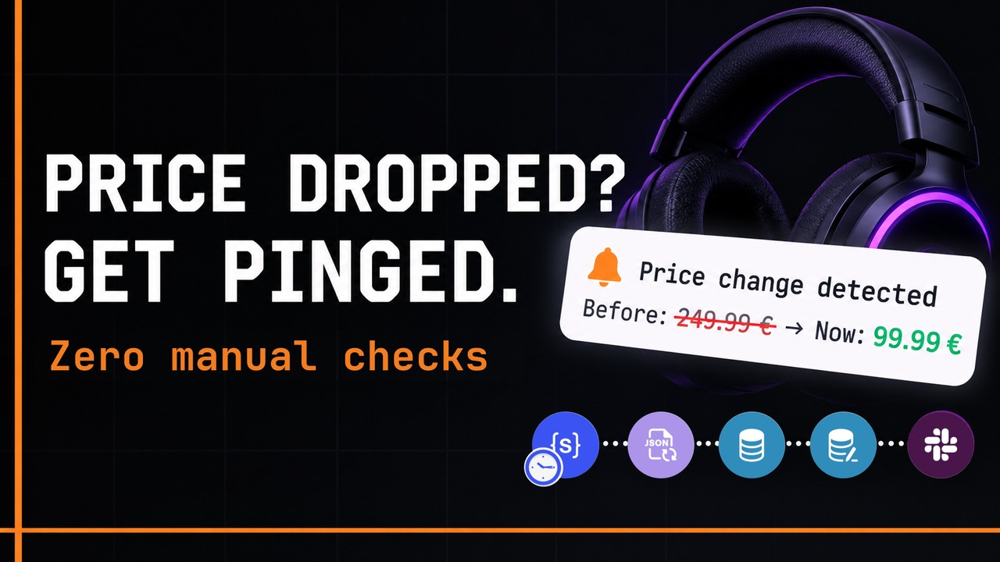

# Price Change Monitor

Watch a retail product page and get a Slack alert when its price changes, whether it goes up or down.

[](https://www.youtube.com/watch?v=0ljhsOSJs3E)

[](https://www.youtube.com/watch?v=0ljhsOSJs3E)

```
🔔 Price change detected
Casque gamer JBL Quantum 910 - sans fil - PS5, Xbox, Switch, PC - jusqu'à 39 heures
Before: 249.99 € → Now: 99.99 €
🏪 Boulanger · 📦 Stock limité
```

---

## How it works

The scenario has 5 modules and 1 filter:

```
Web Scraper (Scrape a website with AI)
  → JSON (Parse JSON)
  → Data store (Get a record)          ← reads the OLD price
  → Data store (Add/replace a record)  ← saves the NEW price
  → [filter: Price changed]
  → Slack (Send a Message)
```

**Save first, compare after.** The scenario saves the new price before comparing, which looks backwards. It works because *Get a record* has already put the old value in the bundle, so the filter still compares the old price with the new one.

| # | Module | Role |
|---|--------|------|
| 1 | Web Scraper › Scrape a website with AI | Opens the product page and returns the product data as JSON |
| 2 | JSON › Parse JSON | Turns the AI's text output into fields you can map |
| 3 | Data store › Get a record | Reads the last known price |
| 4 | Data store › Add/replace a record | Saves the current price |
| – | Filter "Price changed" | Lets the bundle through only if the price changed |
| 5 | Slack › Send a Message | Posts the alert to `#price-alerts` |

---

## Setup

### Prerequisites
- A [Make](https://www.make.com) account
- A **CustomJS** API key for the Web Scraper app. In the CustomJS dashboard, click **Show** under *Your Api Key*.
- A Slack workspace with a channel for alerts, for example `#price-alerts`

### 1. Import the blueprint
In Make, go to **Scenarios › Create a new scenario**, open the **⋯** menu and choose **Import Blueprint**. Select `Price Change Monitor.blueprint.json`.

After the import, reconnect your own **Web Scraper** and **Slack** connections and pick your own data store and channel. The IDs in the blueprint only exist in the original account.

### 2. Create the data store
**Data stores › Add data store**
- **Name:** `price_record`
- **Data structure:** one field `price` (Number)
- **Size:** 1 MB

### 3. Configure the modules

**Web Scraper: Scrape a website with AI**
- **Start URL:** `https://www.boulanger.com/ref/1196271`
- **Output format:** AI extracted JSON
- **Max steps:** 10
- **Goal:**
  ```
  Open https://www.boulanger.com/ref/1196271 and extract the product information. If a cookie banner appears, decline it. Return JSON with these fields: product_name (string), current_price (number, use a dot as decimal separator, no currency symbol), reference_price (number or null), discount_percent (number or null), seller (string), condition ("new" or "refurbished"), stock_status (string).
  ```

Example output (it arrives as **text** in `result.data`):
```json
{
  "product_name": "Casque gamer JBL Quantum 910 - sans fil - PS5, Xbox, Switch, PC - jusqu'à 39 heures",
  "current_price": 99.99,
  "reference_price": 249.99,
  "discount_percent": 60,
  "seller": "Boulanger",
  "condition": "new",
  "stock_status": "Stock limité"
}
```

**JSON: Parse JSON**
- **JSON string:** `{{1.result.data}}`
- **Data structure:** click **Generate** and paste the example output above

**Data store: Get a record**
- **Data store:** `price_record`
- **Key:** `1196271` (the product reference)

**Data store: Add/replace a record**
- **Data store:** `price_record`
- **Key:** `1196271`
- **Overwrite an existing record:** Yes
- **price:** `current_price` (from Parse JSON)

**Filter: Price changed** (between Add/replace and Slack)
| Condition | Value A | Operator | Value B |
|-----------|---------|----------|---------|
| 1 | `price` (Get a record) | Basic › **Exists** | — |
| AND 2 | `current_price` (Parse JSON) | Numeric › **Not equal to** | `price` (Get a record) |

Condition 1 prevents an alert on the first run, when no price is stored yet.

**Slack: Send a Message**
```
🔔 *Price change detected*
*{{product_name}}*
Before: {{price}} € → Now: {{current_price}} €
🏪 {{seller}} · 📦 {{stock_status}}
```
> ⚠️ Map **Before** (`price`) from **Get a record**, not from *Add/replace*. If you take it from *Add/replace*, "Before" shows the new price.

---

## Test it in 3 runs

1. **Run once.** The scenario saves `99.99` and the filter blocks the bundle. This is expected, because there is no old price yet.
2. Go to **Data stores › `price_record` › Browse** and change `price` by hand, for example to `249.99`.
3. **Run once** again. The scenario detects `249.99 → 99.99` and sends the alert to Slack ✅

---

## Cost

- About **$0.015 per run** on CustomJS, which takes 2 browser steps.
- Each run also uses a few Make operations. Run the scenario once a day rather than every 15 minutes.

---

## Notes

- **AI can make mistakes.** The scraper may misread a price, pick the wrong value or miss a change. Always check the price on the product page before you buy. This project is provided as is, with no guarantee of accuracy.
- Retail sites can use **anti-bot protection**. Test each new URL on its own before you add it.
- Respect each website's **terms of use**, and scrape responsibly.

---

## License

[MIT](LICENSE)
